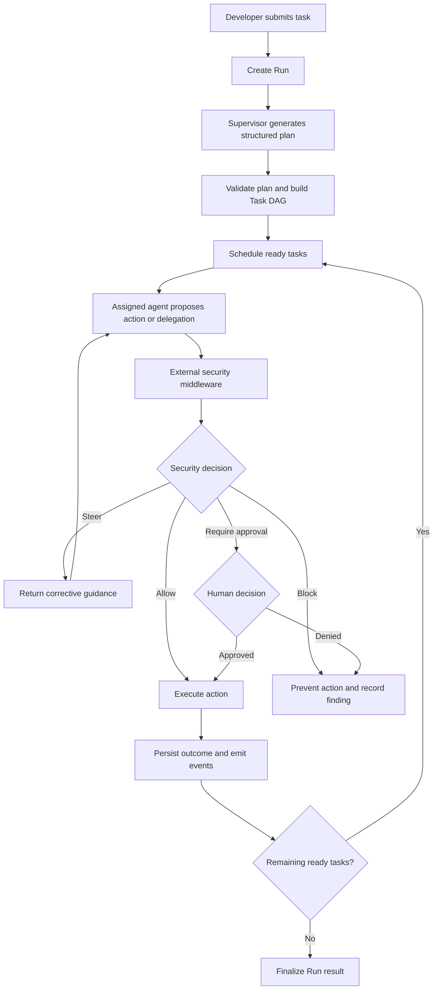

# AgentGuard

**Secure multi-agent orchestration for autonomous coding agents.**

AgentGuard is a platform for delegating software-engineering tasks to autonomous coding agents while keeping **security enforcement, human approvals, and execution visibility outside the agents themselves**.

> **Project status:** Active capstone development. The repository now has a multi-agent Run/Task/AgentExecution path, password-authenticated workspaces backed by PostgreSQL, server-side middleware wiring, container-backed Claude execution, and a web console with a Dashboard, Runs, Run Detail and workspace members. The broader governance and operations-console vision below is only partly implemented. This remains a proof of concept, not production-grade tenant isolation.

## Overview

AgentGuard aims to let developers submit engineering tasks, delegate work to specialized agents, and inspect the complete result. A supervisor coordinates agents, while external middleware reviews consequential tool actions and agent-to-agent delegation before execution. Workspace administrators configure security policies; developers specify the work to perform; authorized reviewers can inspect the evidence.

**Core principle:** Developers control *what* agents are tasked to do. Security administrators control *what agents are permitted to do*. AgentGuard enforces those boundaries and records what happened.

## Existing foundation

The proof of concept currently includes:

- A browser-based coding-agent platform using **Claude**.
- A **React + TypeScript** frontend and **Fastify + TypeScript** backend.
- Multi-agent Runs with task planning, dependency-aware scheduling, isolated working copies, and per-execution container runtimes in password-authenticated mode.
- Strict specialist completion reports that distinguish a successfully ended model turn from a completed Task.
- PostgreSQL-backed users, workspaces, workspace roles, and Run persistence for that mode.
- Run and Task status views, approval handling, and live Run updates in the web app.
- **Deterministic guards** for behavioral invariants (for example, detecting known credentials used in recognized outbound channels).
- A **semantic guard** that compares an agent's apparent objective with the trusted user task and checks for task deviation.
- **Human-in-the-loop (HITL)** approval boundaries and execution interruption.
- **Reflection memory** recording structured lessons from past security incidents.
- Security findings surfaced in the execution trajectory, with replay/evaluation through an existing benchmark framework.

The multi-agent and password-authenticated paths are implemented foundations, with workspace-role checks and capability ceilings. Password mode exposes only workspace-scoped multi-agent APIs. Configurable policy rules, stronger tenant isolation, and web admin for creating users and workspaces remain unfinished. Run copies omit known environment-secret patterns and common credential stores/files by default; this filename-based filter is not general secret detection.

## Planned product capabilities

### 1. Controlled multi-agent orchestration

- Decompose complex software-engineering requests into explicit specialist tasks.
- Coordinate sequential execution and limited parallel execution where dependencies permit.
- Track tasks, dependencies, assigned agents, execution attempts, and results within one overall run.
- Allow controlled agent-to-agent delegation and context passing **without bypassing security middleware**.
- Keep simpler tasks in single-agent mode when appropriate.

### 2. External security enforcement

- Apply deterministic rules to known-dangerous actions and behavioral invariants.
- Use semantic checks to identify objective drift across an execution sequence, even when individual commands look harmless.
- Treat repository content, README files, skills, tool output, and other encountered material as **untrusted instructions**, subordinate to the original user goal and mandatory security constraints.
- Evaluate both tool actions and relevant delegation before allowing them to execute.
- Support decisions to **allow**, **steer**, **block**, or **require human approval**; record reasons and findings.

### 3. Hierarchical policy and access control

- Enforce mandatory **platform policies** that cannot be weakened by workspace administrators.
- Permit **workspace policies** to tighten restrictions for individual projects.
- Associate agents with reusable **capability profiles** covering filesystem, shell/tools, network, write access, and delegation.
- Support workspace roles: `developer`, `security_admin`, and `auditor`.
- Enforce authorization in the backend; frontend role-aware views are supplemental.

### 4. Operations console

The redesigned React frontend is intended to provide:

| View | Planned functionality |
| --- | --- |
| Dashboard | Active/recent runs, agents, pending approvals, security findings, system status |
| Agents | Reusable agent definitions, instructions, profiles, effective capabilities |
| New Run | User task submission and `single` / `auto` orchestration selection |
| Run Detail | Task DAG, agent assignments, statuses, timeline, findings, approvals, changed files, trace drill-down |
| Policies | Platform rules, workspace restrictions, profiles, and effective permissions |
| Approvals | Pending requests, action context, policy reasons, and decisions |
| Security / Audit | Findings, interventions, policy changes, append-only audit history |
| Benchmarks | Benign/adversarial results, security effectiveness, and false interventions |

## Architecture

### Logical data hierarchy

```text
Workspace
├── WorkspaceMembers
├── Agents ──> AgentProfiles / capabilities
├── SecurityPolicies
└── Runs
    ├── Tasks ──> TaskDependencies (DAG edges)
    │   └── AgentExecutions (attempts)
    ├── SecurityFindings
    ├── Approvals
    └── AuditEvents

Agent ──> Reflections ──> ReflectionSightings
```

A **Workspace** is the logical project/security boundary. A **Run** is one complete user request. A **Task** is one unit of work within that run, and an **AgentExecution** is one attempt by a configured agent to execute that task. Retries create separate execution records rather than modifying agent definitions.

### Execution flow



The supervisor's plan should be **structured JSON validated with Zod**. It chooses among registered agents rather than creating unlimited persistent agents. Task count, delegation depth, and parallelism should have practical limits.

### Security evaluation contract

The shared boundary between the orchestrator and security middleware consists of:

| Contract | Purpose |
| --- | --- |
| `SecurityContext` | Trusted identifiers only (workspace, run, task, execution, agent). The middleware loads the user goal, instructions and policy itself (contract decision 2) |
| `ProposedAction` | Normalized command/tool action, file-change action, or delegation action |
| `SecurityDecision` | Outcome (`allow`, `steer`, `block`, `require_approval`), reasons/findings/severity, and optional steering guidance |
| Effective policy | Mandatory platform controls + workspace restrictions + agent capability profile; narrower layers cannot weaken mandatory controls |

```text
Proposed action / delegation
    -> capability and hierarchical policy checks
    -> deterministic guards
    -> semantic alignment review when warranted
    -> ALLOW / STEER / BLOCK / REQUIRE_APPROVAL
    -> execution only when permitted
```

### Workspace isolation and concurrency

Each run gets an isolated working copy instead of modifying a shared permanent directory:

```text
Workspace (logical project)
├── Run 123 -> /runs/123/workspace
└── Run 124 -> /runs/124/workspace
```

Within a run, read-only analysis tasks may run concurrently. Write-capable tasks should initially be serialized to avoid merge/conflict complexity. Multi-agent working copies exclude `.env` and `.env.*` except example/sample/template files, common credential-store directories and filenames, and private-key/state-file extensions. These are filename-based defaults, not general secret detection; unusual secrets in other files can still be copied. This approach is **not a claim of production-grade sandboxing** beyond what is actually demonstrated.

### Data and event conventions

- **PostgreSQL** for multi-user durable state, migrations, foreign keys, and indexing.
- **UUIDs** for primary keys; **UTC** timestamps; validated **JSONB** for flexible capabilities, policies, and evidence.
- Raw **JSONL execution traces** remain outside PostgreSQL; persist references, summaries, statuses, and lineage.
- Append-only `AuditEvent` records for lifecycle, delegation, security, approval, and policy changes.
- A shared **TypeScript/Zod** package for domain types, API payloads, and run events.
- **Server-Sent Events (SSE)** for live run, task, finding, and approval updates; ordinary REST elsewhere.
- A single Fastify backend deployment with clear orchestration, security, and persistence boundaries.

#### Initial status types

| Type | Values |
| --- | --- |
| `WorkspaceRole` | `developer`, `security_admin`, `auditor` |
| `PolicyScope` | `platform`, `workspace` |
| `RunStatus` | `queued`, `planning`, `running`, `waiting_approval`, `completed`, `failed`, `cancelled` |
| `TaskStatus` | `pending`, `ready`, `running`, `waiting_approval`, `completed`, `failed`, `skipped`, `cancelled` |
| `ExecutionStatus` | `queued`, `running`, `waiting_approval`, `completed`, `failed`, `cancelled` |
| `ApprovalStatus` | `pending`, `approved`, `denied`, `timed_out`, `cancelled` |
| `FindingSeverity` | `info`, `low`, `medium`, `high`, `critical` |
| `SecurityLayer` | `deterministic`, `semantic`, `policy`, `memory`, `runtime` |
| `OrchestrationMode` | `single`, `auto` |

## Team workstreams

The plan uses an initial shared backend/foundation phase followed by a coordinated frontend/integration phase.

| Owner | Foundation responsibility | Later frontend responsibility |
| --- | --- | --- |
| **Person 1 — Security** | Extend deterministic/semantic middleware, hierarchical policies, profiles, multi-agent safety, HITL, and security benchmarks | Policy management, effective permissions, findings, approvals |
| **Person 2 — Orchestration** | Run/task scheduling, supervisor planning, dependencies, constrained parallelism, working copies, security evaluation integration, retries/cancellation | Run creation, task graph, task/execution details |
| **Person 3 — Platform** | PostgreSQL schema/migrations, repositories, authentication/RBAC, audit persistence, Docker, CI/CD, deployment, backup/recovery | Auth, workspaces, admin/audit data |
| **Person 4 — Contracts & Integration** | Shared TypeScript/Zod contracts, SSE, API consistency, integration harness and end-to-end tests | Design system/app shell, dashboard, Run Detail composition |

**Integration ownership:** Person 3 coordinates migrations, Person 4 maintains shared contracts after team agreement, and Person 1 and Person 2 agree on the proposed-action/security-decision boundary. Prefer small pull requests and at least weekly integration over large late-stage merges.

## Development roadmap

| Period | Focus | Exit criteria |
| --- | --- | --- |
| Initial alignment week | Agree scope, shared entities/enums, workspace isolation model, security and event interfaces, ownership and branching | **Gate 0:** Skeleton/contracts and working agreement established |
| Week 8 | Parallel security, orchestration, database/auth, and contract/event foundations | Initial backend components implemented against agreed interfaces |
| Week 9 | Secure backend vertical slice | **Gate 1:** One multi-agent run performs real security evaluation, persists outcomes, emits events |
| Week 10 | Complete core backend capabilities | **Gate 2:** Policies, HITL, multi-agent context, scheduling, and API/event contracts largely stable |
| Week 11 | Shared frontend implementation | **Gate 3:** Complete role-aware workflow visible through the frontend |
| Week 12 | Hardening, evaluation, deployment | **Gate 4:** Feature freeze; testing, metrics, deployment and documentation |
| Final week / buffer | Final evidence, documentation, demo | Reproducible demonstration and validated claims |

## Quality and evaluation priorities

- **Security:** Test deterministic guards, semantic task-alignment checks, hierarchical policies, HITL, and cross-agent delegation; measure false interventions as well as successful blocking.
- **Correctness:** Add orchestration, database/API integration, and a small critical end-to-end test suite.
- **Reliability:** Test failures/retries/cancellation, workspace separation, concurrent runs, and event/audit propagation.
- **Operations:** Provide reproducible Docker/local setup, GitHub Actions for lint/typecheck/tests/build, structured logs, secrets hygiene, and basic PostgreSQL backup/recovery.
- **Performance:** Measure API latency, concurrent runs, run duration, and security overhead; optimize observed bottlenecks.
- **Documentation:** Maintain the ERD, architecture, shared contracts/API definitions, setup/deployment guide, evaluation evidence, and cost rationale.

## Explicit non-goals for the core capstone

The team is deliberately **not** prioritizing Kubernetes, Kafka, service mesh, large microservice decomposition, automatic per-agent Git branching/merging, a novelty-driven RAG/vector-database layer, or a full drag-and-drop workflow designer. Git-aware diff/commit support and reusable workflow templates can be considered only after the core secure multi-agent experience works end to end.

## Success criteria

AgentGuard should demonstrate a coherent workflow in which:

1. A developer submits an engineering task and receives a constrained specialist execution plan.
2. Specialist actions and delegations pass through externally enforced security controls.
3. Unsafe or misaligned behavior is blocked, steered, or escalated for human approval.
4. Run/task progress, decisions, security findings, and approvals are persisted and visible.
5. Role-aware operators can understand **what happened, why a decision was made, and who approved it**.

---

*Based on the AgentGuard Product Vision & Work Plan (September 2026). This README describes both existing functionality and the planned capstone direction; it is not an implementation-completeness claim.*
