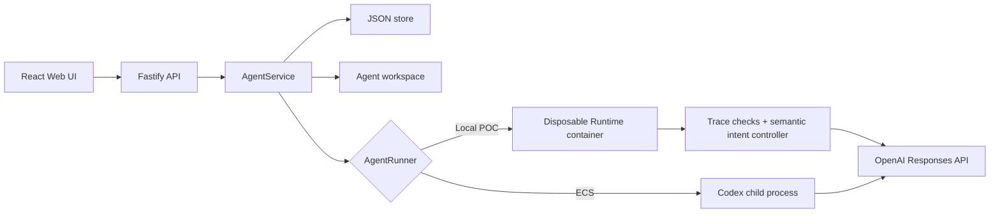
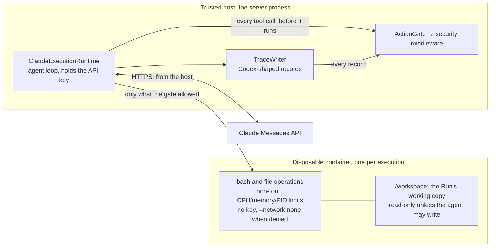

# Architecture

AgentGuard is a single-node control plane for running and supervising coding
agents. It has two modes. **Password mode** is the multi-agent platform: signed-in
users, workspace roles, PostgreSQL and Run → Task → AgentExecution, described under
"Multi-agent model" below. **Token mode** is the original single-agent path: one
shared token and a JSON store. Its routes do not exist in password mode.

The diagram and components here are token mode's.



## Components

### Web UI

Lists Agents, manages lifecycle actions, submits prompts, and polls asynchronous
Runs. It never receives the model API key.

### Fastify API

Validates requests, protects remote demos with a shared bearer token, and
serves the compiled Web UI. The token is not user identity or authorization.

### AgentService

Coordinates lifecycle state, persistence, workspaces, and Runs. One Agent can
have only one active Run.

```text
ready -> busy -> ready
  |       |
  v       v
stopped  error
```

Interrupted Runs become `cancelled` after a restart.

### Storage

```text
data/launchpad.json       Agent, message, and Run metadata
workspaces/AgentID/       Agent-created files
workspaces/.deleted/      Archived deleted workspaces
codex-home/               Codex configuration and sessions
```

`JsonStore` serializes writes and atomically replaces one JSON file. It supports
one process only.

### Runtime providers

- `CodexRunner` runs Codex inside the application container for ECS.
- `ContainerCodexRunner` starts one disposable Docker, Colima, or Podman
  container for every local turn.

Both providers bound output and time, resume the stored Codex thread, and
escalate termination after a grace period. The container provider uses Codex
app-server's bidirectional JSON-RPC stream so the control plane can trace,
approve, steer, and interrupt a live turn. The local-process provider still
uses `codex exec` and does not run the live guard pipeline.

### Guard and semantic control path

```text
verbatim JSON-RPC trace
  ├─ deterministic Check[] ── hard invariant finding
  └─ bounded trajectory state ── async semantic assessment
                                  │
                                  v
                         deterministic IntentController
                         allow / steer / decline / interrupt
```

The original prompt and configured Agent instructions are trusted task context.
Repository files, tool output, reasoning narration, commands, and diffs are
lower-authority evidence. Semantic inference never talks to the Runtime
directly; `runTurn()` remains the only live enforcement point. Derived findings
are persisted on the Run and do not modify the append-only raw trace.

When `GUARDRAIL_SEMANTIC_ENABLED=true`, the container runner resolves an
explicit turn security policy before starting Codex: `workspace-write` sandbox
limited to `/workspace`, `untrusted` approval policy, and denied network. The
writable sandbox exposes Codex's file-change tool; the approval handler remains
the intended pre-execution gate. The runtime interrupts when a file change
completes without an approval request, but that backstop cannot undo the edit.
The pinned Codex 0.111.0 runtime was verified with a local mock Responses API:
it emitted a file-change approval request before applying the patch, and
declining left the isolated workspace file absent. Re-run this check with
`npm run verify:codex-file-change-approval -w @launchpad/server` after building
the local runtime image. For each execution whose resolved policy denies
network, the runtime also passes `web_search="disabled"` to app-server. This
closes the service-side web search path that is outside the workspace's network
sandbox. This does not make every
operation a semantic-model call. It makes every command except a known-safe
read, plus state-changing workspace actions, pause at Codex's real approval
request, where `runTurn()` waits
for prior reasoning assessment, applies deterministic checks, and only then
performs a selected semantic action review. Read/list/search work remains
ungated. A completed file change without its expected approval is recorded as
an enforcement-boundary violation and interrupts the turn, but cannot undo an
already-completed change.

### Multi-agent runs

The multi-agent model is Run → Task → AgentExecution (see
[architecture-direction.md](architecture-direction.md)). It runs alongside the
single-agent path above, which is unchanged. These parts exist:

- **Shared contracts** ([`packages/shared`](../packages/shared)): Zod schemas
  for the domain model, the security contract, run events and API shapes, used
  by both server and web. The reasons are recorded in
  [contract-decisions.md](contract-decisions.md).
- **Live run events:** `RunEventHub` fans out each committed event, with its
  durable seq, and `GET /api/runs/:id/events` streams them as Server-Sent
  Events. Each frame is redacted, and clients resume or resync by seq. Open
  streams poll the Postgres cursor and resync if a different instance commits
  an event; this shares visibility, not orchestration ownership.
- **Security middleware interface**
  ([`security-middleware.ts`](../apps/server/src/security-middleware.ts) and
  [`security-middleware-impl.ts`](../apps/server/src/security-middleware-impl.ts)):
  a concrete policy resolver and one stateful guard per AgentExecution,
  including bounded in-memory run-scoped credential taint. The middleware is
  composed into password-authenticated container-mode server startup. The
  integration harness also exercises the orchestrator and routes, using
  stand-ins for persistence and middleware in its default scenarios; focused
  middleware tests cover the concrete implementation. This is not a full
  production-stack test.
- **Orchestrator**
  ([`apps/server/src/orchestrator`](../apps/server/src/orchestrator/README.md)):
  - plans with a tool-less supervisor call, validates the plan, and delegates
    each task through the middleware;
  - schedules tasks in dependency order, with limited parallelism and one
    write-capable execution at a time;
  - handles retries, approvals, cancellation and restart recovery, and writes
    the audit trail;
  - validates each specialist's strict final disposition, so a successfully
    ended turn cannot complete a Task that the specialist reports incomplete.
- **Run routes** ([`run-routes.ts`](../apps/server/src/run-routes.ts)): create,
  snapshot, cancel and resolve-approval, as specified in `packages/shared/src/api.ts`.
- **Gated Codex runtime**
  ([`gated-turn.ts`](../apps/server/src/gated-turn.ts),
  [`codex-execution-runtime.ts`](../apps/server/src/orchestrator/codex-execution-runtime.ts)):
  one container per execution, on the Run's own working copy. Every approval
  request goes to the middleware, and it fails closed. Each execution mounts a
  disposable Codex home containing only generated provider configuration; the
  shared host Codex home is not mounted into agent containers.
- **Claude runtime**
  ([`claude-execution-runtime.ts`](../apps/server/src/orchestrator/claude-execution-runtime.ts),
  [`claude-tool-sandbox.ts`](../apps/server/src/claude-tool-sandbox.ts)):
  the same port on `MODEL_PROVIDER=anthropic`, with the agent loop on the host and
  the tools in the container. See [below](#the-claude-runtime).
- **Web console** ([`apps/web/src`](../apps/web/src), conventions in
  [`apps/web/DESIGN.md`](../apps/web/DESIGN.md)): a shared shell with real URLs
  (`/`, `/runs`, `/runs/new`, `/runs/:id`, `/playground`, `/safety`, `/members`;
  old `#/runs/...` links redirect). The Dashboard and Runs list read the list-runs
  API. Run Detail has the task graph, the gate timeline and proposed file changes
  from saved rows, the task drill-down and approvals, with live updates from the
  event stream. The sign-in token is kept only in memory, so reloading a tab in
  password mode asks for sign-in again and returns to the same URL.
- **Integration harness**
  ([`apps/server/tests/integration`](../apps/server/tests/integration)): drives
  Runs through the public API and checks the invariants every Run must
  satisfy, against the real orchestrator and routes. Its default scenarios use
  stand-ins for persistence and middleware, so it does not replace a full
  PostgreSQL/container deployment check.

Multi-agent run copies omit `.env` and `.env.*` except example/sample/template
files, common credential stores and filenames, and selected private-key/state
file extensions. Folders named `secrets` are omitted even when they hold source
code. This is a filename-based denylist, not a general secret scanner; secrets
stored under unrecognized names may still be copied. See
[`working-copies.ts`](../apps/server/src/orchestrator/working-copies.ts) for
the exact defaults.

One `auto` Run, end to end. Every arrow into the middleware is a decision that
can allow, steer, block or require approval:

```mermaid
sequenceDiagram
    actor Dev as Developer (browser)
    participant API as Run routes
    participant O as Orchestrator
    participant P as Supervisor planner
    participant M as Security middleware (P1)
    participant R as Agent runtime (Claude or Codex)
    participant S as RunStore + RunEventHub

    Dev->>API: POST /api/workspaces/:id/runs
    API->>O: createRun
    O->>S: Run queued, then planning
    S-->>Dev: run.updated (SSE)
    O->>P: user request + agent list (no workspace content)
    P-->>O: plan as JSON, then schema + validatePlan
    loop each planned task
        O->>M: delegation
        M-->>O: allow / block / require_approval
        O->>S: task.created (only if allowed)
    end
    loop each ready task (dependency order, one writer at a time)
        O->>M: resolvePolicy, then openExecution
        O->>M: context_handoff for each dependency's result
        O->>R: execute(prompt, working copy, gate)
        R->>M: every approval request (command, file change)
        M-->>R: accept / decline / interrupt
        opt require_approval
            O->>S: approval.requested
            S-->>Dev: approval.requested (SSE)
            Dev->>API: POST /api/approvals/:id/resolve
            API->>O: resolveApproval
        end
        R-->>O: validated disposition, result, trace path
        O->>S: execution completed; task completed or failed
    end
    O->>S: Run completed: the final tasks' results
    S-->>Dev: run.updated (SSE)
```

Multi-user mode is `APP_AUTH_MODE=password`, with `DATABASE_URL` and
`RUNTIME_PROVIDER=container`. Users sign in with accounts kept in Postgres
instead of the shared token, and `index.ts` composes the orchestrator with
`PostgresRunStore`, `PostgresAgentDirectory`, P1's middleware on
`PostgresSecuritySource`, the model planner and one disposable container per
execution, on Claude or Codex by `MODEL_PROVIDER`
([`postgres-runs.ts`](../apps/server/src/postgres-runs.ts)). In a workspace,
any role may read bounded Run data; `developer` and `security_admin` may also
start and cancel Runs and read redacted raw execution traces. An `auditor` reads
snapshots and the bounded timeline, but not raw traces. An approval needs the person
who started the Run, or a `security_admin` when its reason is `policy_required`
(contract decision 19). What always asks a person is decision 20, and editing agents,
profiles and policies is decision 21. `npm run db:admin -w
@launchpad/server` bootstraps the first users and registers host project paths;
it also lists users/workspaces and can create empty workspaces. A
`security_admin` can create accounts attached to their workspace, manage its
members, and create additional empty workspaces (contract decision 15). Password
sign-in currently has no failed-attempt rate limit (contract decision 27 records
the removed design). Run streams detect commits made by another instance and
ask the client to reload its snapshot, but orchestration waiters, cancellation,
approval coordination and run-scoped taint remain process-local. Keep the app
single-instance. The
default `token` mode is unchanged, and `npm run dev:demo` still runs the simulated
demo. For the two acting roles, an attempt's bounded, redacted raw trace is read through
`GET /api/runs/:runId/executions/:executionId/trace`, under the same workspace
check as the other run routes. Password mode rejects the legacy global
`/api/agents`, `/api/admin`, `/api/system` and single-agent Run routes because
their JSON store has no workspace identity to authorize against.

Each Run has a token budget (`RUN_TOKEN_BUDGET`). Files of a finished Run
are removed after `RUN_ARTIFACT_RETENTION_DAYS` (contract decision 18), while its rows
stay, and reading such a trace answers 410 rather than a plain 404.

Not built yet, by owner:
- **P1:** multi-agent reflection memory now loads and folds structured findings
  into the existing PostgreSQL reflection/sighting tables for later Runs. Its
  live efficacy has not yet been measured. A PostgreSQL-backed live Run/Task
  benchmark harness now exists at
  `benchmark/run-multi-agent-live.ts`; it has not yet been run against a live
  model/runtime. Policy `rules` stay unsupported until P1 reviews a schema, so
  nothing yet produces `policy_required`.
- **P3:** tenant isolation beyond workspace roles (every workspace's Runs share one
  host). First-account bootstrap and host project paths stay operator-only
  (decision 15); workspace admins can create accounts in their workspace and
  empty workspaces. Sign-in has no limit on failed attempts (contract decision 27).
  Migrating token-mode JSON records
  was decided against (decision 23). The
  integration harness still runs on `InMemoryRunStore`; the fuzz suite and the
  store suite are what exercise Postgres.
- **P3/P4:** applied file changes on the gate timeline. Saved data does not hold
  them, so the timeline says so. Command text is saved redacted and bounded in
  audit metadata (contract decision 14).

The password-mode console includes workspace Agents and Policies management,
Approvals, Security findings and audit history, and saved Benchmarks reports.
Workspace routes check membership and enforce role/version rules in the server;
the UI only reflects those permissions. Benchmark reports are read from
committed results and are not live measurements or runs initiated by the UI.

Orchestration test and load results are in
[orchestration-evaluation.md](orchestration-evaluation.md).

### The Claude runtime

`MODEL_PROVIDER=anthropic` replaces Codex on the multi-agent path. It has been
proven against a local mock of the API and in real containers, and has not yet run
against the real API. Codex's code stays, and removing it waits for that proof.



**Why the gate holds by construction.** The model has no way to act except by asking
the loop. A `tool_use` block is a request, and the loop is the only thing that can
carry it out, so the gate does not depend on an agent CLI honouring an approval
protocol. Nothing in the container talks to the model, so a stopped loop stops
everything.

**This closes the open egress problem for this path.** The Codex container needs a
bridge network to reach its model, which [handover.md](../handover.md) records as an
open problem: `--network none` would also stop model requests. Here the model call
stays on the host, so a policy that denies network gives the container no network at
all, with no provider-only egress path to build or trust. It stays open for Codex.

**The same semantics as Codex.** Commands and file changes go through
`ActionGate.decide` with the shapes `gated-turn.ts` uses. Allow and steer run; a
block with `stop: "action"` refuses and goes on; a block with `stop: "execution"` ends
the loop with no further model call; an error from the gate fails closed. A refusal
reaches the model as a `tool_result` with `is_error`. Corrections from the middleware
arrive as text after the tool results, never inside one.

**Trace records** copy a real Codex trace, down to the ordering of approval requests
and the `declined` item a refusal leaves
([`benchmark-results/`](../benchmark-results/2026-08-31-slice) holds real ones), so
the deterministic checks, trajectory state, findings, trace route, web trace view
and benchmark scorers read them unchanged. Thinking summaries become `reasoning`
items, which is what the agent-intent check and the semantic monitor read. One
consequence is shared with Codex: re-running the checks over a declined egress
attempt fires `sensitive-egress` in `observe`, which ends the execution, so a
refused send after a secret read stops the attempt rather than only the action.

**Where it differs from Codex**, in order of consequence:

| | Codex | Claude |
| --- | --- | --- |
| API key | In the container's environment | On the host only |
| Network denied | Inner sandbox, in a bridged container | No network in the container |
| Reads | Known-safe commands skip the gate | Every command reaches the gate, including reads, so the guard's cost and its evidence both rise slightly |
| Commands the gate sees | Wrapped in `bash -lc` | The text the model wrote |
| Read-only agents | Writable mount, gate only | Read-only mount as well |
| Read-only agents' compound reads | Codex's parser allows `ls && cat a` | Refused, because the middleware's set accepts only single plain commands. The system prompt tells the agent. |
| Inner sandbox | Landlock where available | None. The container is the boundary, so a writer can change anything its user can inside it, such as `/tmp`, through the gate. |
| Editing | `apply_patch`, applied by Codex | Read in the container, then gated, then written if the file still hashes the same, following no symlink |

**File edits and symlinks.** Paths with `..` or outside `/workspace` are refused on
the host, before the gate. Inside the container, a fixed script checks every parent
with `lstat`, opens with `O_NOFOLLOW`, and verifies the open descriptor through
`/proc/self/fd` before reading or writing. It runs in the container, so a path can
only ever resolve against the container's filesystem, never the host's. A process in
the same container racing to swap a directory can at worst leave an empty file
elsewhere in that container, which a gated shell command could do anyway.

**Limits**, all configurable, per execution: model turns, tokens per call, total
input and output tokens, model and tool time, command time, tool output, and edit
size. They bound an attempt, and the orchestrator retries a failed attempt once, as
it does any crash. The refusal and limit errors say which setting was hit.

**Claude API use.** `claude-opus-5-5` by default, with `output_config.effort` set,
adaptive thinking with summaries, streaming with `finalMessage()`, `tool_choice:
auto`, the Anthropic-defined `bash_20250124` and `text_editor_20250728` tools, a
frozen system prompt with prompt caching, and the server-side `fallbacks: "default"`
opt-in (beta `server-side-fallback-2026-07-01`). History is passed back unchanged,
with one exception the API requires: after a mid-output fallback, the declined
attempt's thinking and tool calls are left out, and those tool calls never run. The
supervisor planner and the semantic monitor call Claude too, with structured
outputs, the same prompts, schemas, timeouts and fail-closed behaviour, and
`GUARDRAIL_SEMANTIC_MODEL` as the monitor's override.

**The legacy path.** `AgentService` and `run-turn.ts` are unchanged and need Codex.
Under this provider the message route answers 503 with the reason, and the Playground
and Safety pages say so; the web app reads `modelProvider`, which `/api/system`
already returned.

Run the boundary probe with `npm run verify:claude-runtime -w @launchpad/server`. It
uses real Docker, a mock API and no key, and is not part of `npm test`.

## Deployment profiles

| Profile | Control plane | Agent execution |
| --- | --- | --- |
| Local POC | Host Node.js | Disposable local container (Codex in it, or Claude's tools with the loop on the host) |
| Multi-agent host (`scripts/deploy-multi-agent.sh`) | Host Node.js under systemd, Postgres in Compose | Disposable local container |
| ECS | Application container | Codex process in the same container |
| Local development | Host Node.js | Host Codex process |

## Extension seams

| Track | Primary seam | Expected change |
| --- | --- | --- |
| Glass Box | `AgentRunner`, `AgentRun` | Emit and display correlated execution events. |
| Bouncer | API routes, Agent ownership | Add identity and server-side authorization. |
| Kill Switch | `AgentRunner` | Add threat-specific policy or a stronger sandbox. |

The current container or ECS instance is the POC trust boundary. Ordinary
containers are not hardened multi-tenant isolation. Agent network access is
denied in the Codex sandbox, but this is not a host-enforced provider-only
egress path. The multi-agent deployment refuses `danger-full-access` and fails
if its configured workspace-write sandbox cannot be verified; real-host
deployment validation is still required.
