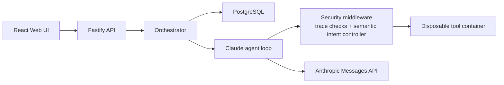

# Architecture

AgentGuard is a single-node control plane for running and supervising coding
agents, with Claude as the agent. **Password mode** is the platform: signed-in users,
workspace roles, PostgreSQL and Run → Task → AgentExecution. **Token mode** only
serves the simulated `RUNS_DEMO`.



## Components

### Web UI

Dashboard, Runs, approvals and workspace administration. It never receives the
model API key.

### Fastify API

Validates requests, signs users in, and serves the compiled Web UI.

### Guard and semantic control path

```text
verbatim trace
  ├─ deterministic Check[] ── hard invariant finding
  └─ bounded trajectory state ── async semantic assessment
                                  │
                                  v
                         deterministic IntentController
                         allow / steer / decline / interrupt
```

The original prompt and configured Agent instructions are trusted task context.
Repository files, bounded read excerpts, tool output, reasoning narration,
commands, and diffs are lower-authority evidence. Semantic action review
receives an itemized effect list covering every part of the proposal: each
shell clause (heredoc bodies stay with their command), each changed file, and
any text longer than one effect split into parts with stable ids, none
clipped. Action review packs up to four calls of at most 24 effects and 48,000
input characters each. A proposal beyond this bounded budget is held for a person; an itemized
result must assess every effect, and a conflicting effect's risk is not
averaged away by an aligned effect.

In password mode, once every execution has stopped, the Run's actual diff is
reviewed against the original prompt, the bounded gated-action ledger and the
server-loaded approvals before a changed Run can complete
([`semantic-run-diff.ts`](../apps/server/src/semantic-run-diff.ts)). The
review first checks coverage: a missing or older baseline, a stopped scan, an
entry that could not be compared, changed content not fully available
(binary, text over 256 KB, unreadable, credential-named or link entries), more than
36 changed files, an over-long action ledger, or changes too large for its
input budget make it `incomplete` without any model call. Otherwise every
changed hunk becomes one or more effects in bounded batches, and each must
come back assessed. An approval covers a conflicting change only when it was
approved, its saved proposal is complete, a file-change approval names that
path, the reviewer says the change is exactly that proposal, and the risk is
below the 0.75 block threshold. The outcome (`aligned`, `conflict`,
`incomplete`, `unavailable`, `no_changes`, `not_run` or `disabled`), its
coverage counts, risk, safe rationale and the review model's own usage are
saved on `Run.finalReview` for success and failure alike. A conflict at 0.50
or more, incomplete evidence or an unavailable review fails the Run, so its
copy does not seed the next Run; this is a post-execution backstop, not
rollback. The review runs outside the Run's lock and a cancel aborts it, so a
cancelled Run never completes afterwards. Semantic inference never talks to
the Runtime directly; the middleware's ActionGate is the only live
enforcement point. Derived findings are persisted and do not modify the
append-only raw trace.

### Multi-agent runs

The multi-agent model is Run → Task → AgentExecution (described here). It runs alongside the
Claude runtime. These parts exist:

- **Shared contracts** ([`packages/shared`](../packages/shared)): Zod schemas
  for the domain model, the security contract, run events and API shapes, used
  by both server and web. The reasons are recorded in
  [contract-decisions.md](contract-decisions.md).
- **Live run events:** `RunEventHub` fans out each committed event, with its
  durable seq, and `GET /api/runs/:id/events` streams them as Server-Sent
  Events. Each frame is redacted, and clients resume or resync by seq. Open
  streams poll the Postgres cursor and resync if a different instance commits
  an event; this shares visibility, not orchestration ownership.
- **Security middleware interface**
  ([`security-middleware.ts`](../apps/server/src/security-middleware.ts) and
  [`security-middleware-impl.ts`](../apps/server/src/security-middleware-impl.ts)):
  a concrete policy resolver and one stateful guard per AgentExecution,
  including bounded in-memory run-scoped credential taint. The middleware is
  composed into password-authenticated container-mode server startup. The
  integration harness also exercises the orchestrator and routes, using
  stand-ins for persistence and middleware in its default scenarios; focused
  middleware tests cover the concrete implementation. This is not a full
  production-stack test.
- **Workspace vault:** workspace entries are AES-256-GCM encrypted under
  `APP_DATA_DIR/vault`, using the operator-provided
  `AGENTGUARD_VAULT_MASTER_KEY`. The API returns metadata only. A Run grants
  named entries to specific agents; the values stay in server memory and are
  passed only to the host-side HTTPS broker, never into the container or
  workspace. The broker limits requests to exact per-entry hostnames, GET/POST,
  port 443, public IPv4 destinations, no redirects, and bounded request and
  response sizes. Exact values seed run-scoped taint and are redacted from
  traces, broker output, and summaries. Direct egress remains subject to the
  normal network capability and approval gate. This is local POC storage, not a
  production multi-tenant vault.
- **Orchestrator**
  ([`apps/server/src/orchestrator`](../apps/server/src/orchestrator/README.md)):
  - starts each follow-up Run from the latest completed Run's working copy,
    while keeping a separate Run, task graph, security context and audit history;
  - serializes Runs per workspace and supplies bounded prior prompts/reports
    as untrusted context, with the current prompt remaining authoritative;
  - plans with a tool-less supervisor call, validates the plan, and delegates
    each task through the middleware;
  - schedules tasks in dependency order, with limited parallelism and one
    write-capable execution at a time;
  - handles retries, approvals, cancellation and restart recovery, and writes
    the audit trail;
  - validates each specialist's strict final disposition, so a successfully
    ended turn cannot complete a Task that the specialist reports incomplete.
- **Run routes** ([`run-routes.ts`](../apps/server/src/run-routes.ts)): create,
  snapshot, cancel and resolve-approval, as specified in `packages/shared/src/api.ts`.
- **Claude runtime**
  ([`claude-execution-runtime.ts`](../apps/server/src/orchestrator/claude-execution-runtime.ts),
  [`claude-tool-sandbox.ts`](../apps/server/src/claude-tool-sandbox.ts)):
  the agent loop on the host and
  the tools in a container per execution, on the Run's own working copy. See [below](#the-claude-runtime).
- **Web console** ([`apps/web/src`](../apps/web/src), conventions in
  [`apps/web/DESIGN.md`](../apps/web/DESIGN.md)): a shared shell with real URLs
  (`/`, `/runs`, `/runs/new`, `/runs/:id`, `/members`;
  old `#/runs/...` links redirect). The Dashboard and Runs list read the list-runs
  API. Run Detail has the task graph, the gate timeline and proposed file changes
  from saved rows, the task drill-down and approvals, with live updates from the
  event stream. The sign-in token is kept only in memory, so reloading a tab in
  password mode asks for sign-in again and returns to the same URL.
- **Integration harness**
  ([`apps/server/tests/integration`](../apps/server/tests/integration)): drives
  Runs through the public API and checks the invariants every Run must
  satisfy, against the real orchestrator and routes. Its default scenarios use
  stand-ins for persistence and middleware, so it does not replace a full
  PostgreSQL/container deployment check.

Multi-agent run copies omit `.env` and `.env.*` except example/sample/template
files, common credential stores and filenames, and selected private-key/state
file extensions. Folders named `secrets` are omitted even when they hold source
code. This is a filename-based denylist, not a general secret scanner; secrets
stored under unrecognized names may still be copied. See
[`working-copies.ts`](../apps/server/src/orchestrator/working-copies.ts) for
the exact defaults.

One `auto` Run, end to end. Every arrow into the middleware is a decision that
can allow, steer, block or require approval:

```mermaid
sequenceDiagram
    actor Dev as Developer (browser)
    participant API as Run routes
    participant O as Orchestrator
    participant P as Supervisor planner
    participant M as Security middleware (P1)
    participant R as Agent runtime (Claude)
    participant S as RunStore + RunEventHub

    Dev->>API: POST /api/workspaces/:id/runs
    API->>O: createRun
    O->>S: Run queued, then planning
    S-->>Dev: run.updated (SSE)
    O->>P: user request + agent list (no workspace content)
    P-->>O: plan as JSON, then schema + validatePlan
    loop each planned task
        O->>M: delegation
        M-->>O: allow / block / require_approval
        O->>S: task.created (only if allowed)
    end
    loop each ready task (dependency order, one writer at a time)
        O->>M: resolvePolicy, then openExecution
        O->>M: context_handoff for each dependency's result
        O->>R: execute(prompt, working copy, gate)
        R->>M: every approval request (command, file change)
        M-->>R: accept / decline / interrupt
        opt require_approval
            O->>S: approval.requested
            S-->>Dev: approval.requested (SSE)
            Dev->>API: POST /api/approvals/:id/resolve
            API->>O: resolveApproval
        end
        R-->>O: validated disposition, result, trace path
        O->>S: execution completed; task completed or failed
    end
    O->>S: Run completed: the final tasks' results
    S-->>Dev: run.updated (SSE)
```

Multi-user mode is `APP_AUTH_MODE=password`, with `DATABASE_URL`. Users sign in with accounts kept in Postgres
instead of the shared token, and `index.ts` composes the orchestrator with
`PostgresRunStore`, `PostgresAgentDirectory`, P1's middleware on
`PostgresSecuritySource`, the model planner and one disposable container per
execution for Claude's tools
([`postgres-runs.ts`](../apps/server/src/postgres-runs.ts)). In a workspace,
any role may read bounded Run data; `developer` and `security_admin` may also
start and cancel Runs and read redacted raw execution traces. An `auditor` reads
snapshots and the bounded timeline, but not raw traces. An approval needs the person
who started the Run, or a `security_admin` when its reason is `policy_required`
(contract decision 19). What always asks a person is decision 20, and editing agents,
profiles and policies is decision 21. `npm run db:admin -w
@launchpad/server` bootstraps the first users and registers host project paths;
it also lists users/workspaces and can create empty workspaces. A
`security_admin` can create accounts attached to their workspace, manage its
members, and create additional workspaces, with a project folder only inside the
operator's `WORKSPACE_SOURCE_ROOTS` (contract decisions 15 and 32), or upload a
validated ZIP to an empty workspace before its first Run. ZIP extraction is
bounded and rejects links, traversal and known credential files. Password
sign-in has a process-local failed-attempt limit; counters reset on restart and
are not shared across replicas (contract decision 27). Run streams detect commits made by another instance and
ask the client to reload its snapshot, but orchestration waiters, cancellation,
approval coordination and run-scoped taint remain process-local. Keep the app
single-instance. The
default `token` mode is unchanged, and `npm run dev:demo` still runs the simulated
demo. For the two acting roles, an attempt's bounded, redacted raw trace is read through
`GET /api/runs/:runId/executions/:executionId/trace`, under the same workspace
check as the other run routes.

Each Run has a shared model token budget (`RUN_TOKEN_BUDGET`) across planner,
agent execution, semantic action/reasoning calls and final review. Before a call,
its UTF-8 input bytes plus a 16,000-token protocol/schema allowance and maximum
output are reserved synchronously, including concurrent calls. Reported usage
(including cache tokens) replaces that reservation; unknown/failed usage keeps
the conservative charge. Twenty percent, capped at 128,000 tokens, is reserved
for final review when enabled. It is an admission estimate, not a provider billing
guarantee; an unexpectedly larger reported charge stops subsequent admissions.
The final receipt saves the ledger separately from per-execution token counts.
Expired Run files and traces
are removed after `RUN_ARTIFACT_RETENTION_DAYS` (contract decision 18), except
the latest successfully completed workspace copy, which remains available as
the starting point for its next Run. Rows stay, and reading an expired trace
answers 410 rather than a plain 404.

Remaining implementation and validation gaps:
- **P1:** multi-agent reflection memory loads and folds structured findings
  into the existing PostgreSQL reflection/sighting tables for later Runs. Its
  live efficacy has not yet been measured. The PostgreSQL-backed Run/Task
  harness has run a small Claude sample; see
  [guard evaluation results](GUARD_EVALUATION_RESULTS.md). Those runs do not
  establish a general guard detection rate. Policy `rules` stay unsupported
  until P1 reviews a schema, so nothing yet produces `policy_required`.
- **P3:** tenant isolation beyond workspace roles (every workspace's Runs share one
  host). First-account bootstrap and host project paths stay operator-only
  (decision 15); workspace admins can create accounts in their workspace and
  empty workspaces. Migrating token-mode JSON records
  was decided against (decision 23). The
  integration harness still runs on `InMemoryRunStore`; the fuzz suite and the
  store suite are what exercise Postgres.
- **P3/P4:** the baseline and the final scan are the same bounded walk
  ([`workspace-snapshot.ts`](../apps/server/src/workspace-snapshot.ts)):
  500 files, 16 levels, 20,000 directory entries, 64 MB streamed hashes per file and
  128 MB in total, at most eight concurrent file reads, a five-second deadline
  checked between 64 KB reads, 256 KB of text per file and 2 MB of baseline text, with
  `node_modules`, `.git` and `.codex` excluded on both sides at any depth.
  Those are exactly the folders a copy never carries forward, so nothing the
  review cannot see seeds a follow-up Run; build output is scanned. Links are recorded by target and never followed;
  credential-named paths are hashed but their contents are never captured. A
  line diff with positions ([`line-diff.ts`](../apps/server/src/line-diff.ts),
  [`run-diff.ts`](../apps/server/src/run-diff.ts)) is written atomically next
  to the copy once execution has stopped, as a versioned artifact with
  separate inventory and content coverage. A present file that could not be
  read is changed or uncertain, never deleted, and a missing or older
  baseline is reported as such (an unknown count), never replaced by one
  captured after edits. The diff route answers only for ended Runs. This is
  separate from the gate timeline, which records proposed changes and
  decisions; an allowed proposal does not prove that a change was applied.
  Command text is saved redacted and bounded in audit metadata (contract
  decision 14).

The password-mode console includes workspace Agents, Policies, Credentials and
Members management, Approvals, Security findings and audit history, and saved
Benchmarks reports. The New Run form previews an agent's effective permissions,
offers as supervisors only agents whose effective policy can delegate, and
supports per-agent vault grants. Run Detail's receipt states how the Run ended,
what changed (unknown when it cannot be compared), the saved final review and
its coverage, and agent execution tokens labelled as excluding planning and
review calls. Approval cards show the hold reason and the exact redacted
proposal; Approve is unavailable when no proposal was saved, and the server
refuses it too. The per-file control downloads a redacted text preview of at
most 256 KB; the ZIP carries full bytes within its limits and reports what it
left out. A follow-up keeps the agent the Run used (or asks for one) and names
the latest completed Run it will start from.
Workspace routes check membership and enforce role/version rules in the server;
the UI only reflects those permissions. Benchmark reports are read from
committed results and are not live measurements or runs initiated by the UI.

Orchestration test and load results are in
[orchestration-evaluation.md](orchestration-evaluation.md).

### The Claude runtime

The only agent runtime. See [contract decision 31](contract-decisions.md#31-claude-is-the-only-runtime).


**Why the gate holds by construction.** The model has no way to act except by asking
the loop. A `tool_use` block is a request, and the loop is the only thing that can
carry it out, so the gate does not depend on an agent CLI honouring an approval
protocol. Nothing in the container talks to the model, so a stopped loop stops
everything.

**No provider-only egress path to build.** The model call stays on the host, so a
policy that denies network gives the container no network at all.

**Semantics.** Commands and file changes go through `ActionGate.decide`. Allow and steer run; a
block with `stop: "action"` refuses and goes on; a block with `stop: "execution"` ends
the loop with no further model call; an error from the gate fails closed. A refusal
reaches the model as a `tool_result` with `is_error`. Corrections from the middleware
arrive as text after the tool results, never inside one.

**Trace records** keep the JSON-RPC shape of the recorded traces, down to the ordering of approval requests
and the `declined` item a refusal leaves
([`benchmark-results/`](../benchmark-results/2026-08-31-slice) holds real ones), so
the deterministic checks, trajectory state, findings, trace route, web trace view
and benchmark scorers read them unchanged. Provider-returned thinking summaries, when available, become `reasoning`
items; private chain of thought is not exposed. Visible pre-tool action summaries are marked separately; both feed the
semantic monitor. Claude may omit thinking summaries, so the gate also reviews
all commands not proven read-only and all file changes before execution. One
consequence: re-running the checks over a declined egress
attempt fires `sensitive-egress` in `observe`, which ends the execution, so a
refused send after a secret read stops the attempt rather than only the action.

**Its boundaries**, in order of consequence:

| | Claude |
| --- | --- |
| API key | On the host only |
| Network | Denied unless the operator enables `AGENT_NETWORK_ACCESS`; a vault grant does not enable container networking. Direct outbound commands in a vault-granted Run require human approval. Approved broker requests are checked against the executing agent's exact host grants. |
| Reads | Every command reaches the gate, including reads, so the guard's cost and its evidence both rise slightly |
| Commands the gate sees | The text the model wrote |
| Read-only agents | Read-only mount as well as the gate |
| Read-only agents' compound reads | Refused, because the middleware's set accepts only single plain commands. The system prompt tells the agent. |
| Inner sandbox | None. The container is the boundary, so a writer can change anything its user can inside it, such as `/tmp`, through the gate. |
| Editing | Read in the container, then gated, then written if the file still hashes the same, following no symlink |

**File edits and symlinks.** Paths with `..` or outside `/workspace` are refused on
the host, before the gate. Inside the container, a fixed script checks every parent
with `lstat`, opens with `O_NOFOLLOW`, and verifies the open descriptor through
`/proc/self/fd` before reading or writing. It runs in the container, so a path can
only ever resolve against the container's filesystem, never the host's. A process in
the same container racing to swap a directory can at worst leave an empty file
elsewhere in that container, which a gated shell command could do anyway.

**Limits**, all configurable, per execution: model turns, tokens per call, total
input and output tokens, model and tool time, command time, tool output, and edit
size. They bound an attempt, and the orchestrator retries a failed attempt once, as
it does any crash. The refusal and limit errors say which setting was hit.

**Claude API use.** `claude-opus-5-5` by default, with `output_config.effort` set,
adaptive thinking with summaries, streaming with `finalMessage()`, `tool_choice:
auto`, the Anthropic-defined `bash_20250124` and `text_editor_20250728` tools, a
frozen system prompt with prompt caching, and the server-side `fallbacks: "default"`
opt-in (beta `server-side-fallback-2026-07-01`). History is passed back unchanged,
with one exception the API requires: after a mid-output fallback, the declined
attempt's thinking and tool calls are left out, and those tool calls never run. The
supervisor planner and the semantic monitor call Claude too, with structured
outputs, the same prompts, schemas, timeouts and fail-closed behaviour, and
`GUARDRAIL_SEMANTIC_MODEL` as the monitor's override.

Run the boundary probe with `npm run verify:claude-runtime -w @launchpad/server`. It
uses real Docker, a mock API and no key, and is not part of `npm test`.

## Deployment profiles

| Profile | Control plane | Agent execution |
| --- | --- | --- |
| Local POC | Host Node.js | Claude's loop on the host, tools in a disposable local container |
| Multi-agent host (`scripts/deploy-multi-agent.sh`) | Host Node.js under systemd, Postgres in Compose | Disposable local container |
| Local development (`npm run dev:demo`) | Host Node.js | Simulated |

The tool container is the POC trust boundary. Ordinary containers are not hardened
multi-tenant isolation. Denied network means a container with no network; a profile
that allows network gets a bridge, not a provider-only egress path. Real-host
deployment validation is still required.
