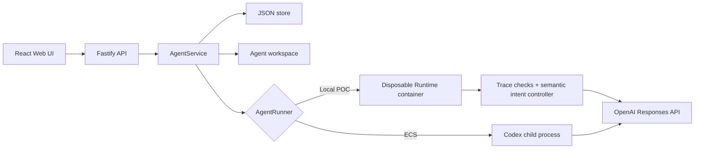
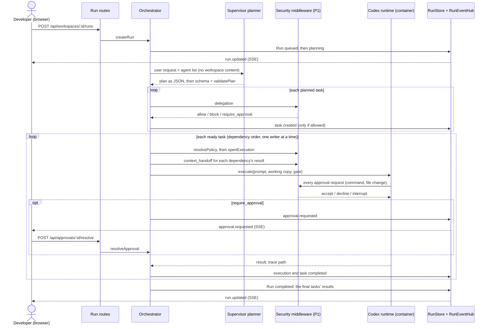

# Architecture

Agent Launchpad is a single-node control plane for running and supervising
Codex-based Agents.



## Components

### Web UI

Lists Agents, manages lifecycle actions, submits prompts, and polls asynchronous
Runs. It never receives the model API key.

### Fastify API

Validates requests, protects remote demos with a shared bearer token, and
serves the compiled Web UI. The token is not user identity or authorization.

### AgentService

Coordinates lifecycle state, persistence, workspaces, and Runs. One Agent can
have only one active Run.

```text
ready -> busy -> ready
  |       |
  v       v
stopped  error
```

Interrupted Runs become `cancelled` after a restart.

### Storage

```text
data/launchpad.json       Agent, message, and Run metadata
workspaces/AgentID/       Agent-created files
workspaces/.deleted/      Archived deleted workspaces
codex-home/               Codex configuration and sessions
```

`JsonStore` serializes writes and atomically replaces one JSON file. It supports
one process only.

### Runtime providers

- `CodexRunner` runs Codex inside the application container for ECS.
- `ContainerCodexRunner` starts one disposable Docker, Colima, or Podman
  container for every local turn.

Both providers bound output and time, resume the stored Codex thread, and
escalate termination after a grace period. The container provider uses Codex
app-server's bidirectional JSON-RPC stream so the control plane can trace,
approve, steer, and interrupt a live turn. The local-process provider still
uses `codex exec` and does not run the live guard pipeline.

### Guard and semantic control path

```text
verbatim JSON-RPC trace
  ├─ deterministic Check[] ── hard invariant finding
  └─ bounded trajectory state ── async semantic assessment
                                  │
                                  v
                         deterministic IntentController
                         allow / steer / decline / interrupt
```

The original prompt and configured Agent instructions are trusted task context.
Repository files, tool output, reasoning narration, commands, and diffs are
lower-authority evidence. Semantic inference never talks to the Runtime
directly; `runTurn()` remains the only live enforcement point. Derived findings
are persisted on the Run and do not modify the append-only raw trace.

When `GUARDRAIL_SEMANTIC_ENABLED=true`, the container runner resolves an
explicit turn security policy before starting Codex: `read-only` sandbox,
`untrusted` approval policy, and denied network. This does not make every
operation a semantic-model call. It makes every command except a known-safe
read, plus state-changing workspace actions, pause at Codex's real approval
request, where `runTurn()` waits
for prior reasoning assessment, applies deterministic checks, and only then
performs a selected semantic action review. Read/list/search work remains
ungated. A completed file change without its expected approval is recorded as
an enforcement-boundary violation and interrupts the turn, but cannot undo an
already-completed change.

### Multi-agent runs

The multi-agent model is Run → Task → AgentExecution (see
[architecture-direction.md](architecture-direction.md)). It runs alongside the
single-agent path above, which is unchanged. These parts exist:

- **Shared contracts** ([`packages/shared`](../packages/shared)): Zod schemas
  for the domain model, the security contract, run events and API shapes, used
  by both server and web. The reasons are recorded in
  [contract-decisions.md](contract-decisions.md).
- **Live run events:** `RunEventHub` fans out each committed event, with its
  durable seq, and `GET /api/runs/:id/events` streams them as Server-Sent
  Events. Each frame is redacted, and clients resume or resync by seq.
- **Security middleware interface**
  ([`security-middleware.ts`](../apps/server/src/security-middleware.ts) and
  [`security-middleware-impl.ts`](../apps/server/src/security-middleware-impl.ts)):
  a concrete policy resolver and one stateful guard per AgentExecution,
  including bounded in-memory run-scoped credential taint. The middleware is
  exercised through the orchestrator integration harness, but is not composed
  into normal server startup.
- **Orchestrator**
  ([`apps/server/src/orchestrator`](../apps/server/src/orchestrator/README.md)):
  - plans with a tool-less supervisor call, validates the plan, and delegates
    each task through the middleware;
  - schedules tasks in dependency order, with limited parallelism and one
    write-capable execution at a time;
  - handles retries, approvals, cancellation and restart recovery, and writes
    the audit trail.
- **Run routes** ([`run-routes.ts`](../apps/server/src/run-routes.ts)): create,
  snapshot, cancel and resolve-approval, as specified in `packages/shared/src/api.ts`.
- **Gated Codex runtime**
  ([`gated-turn.ts`](../apps/server/src/gated-turn.ts),
  [`codex-execution-runtime.ts`](../apps/server/src/orchestrator/codex-execution-runtime.ts)):
  one container per execution, on the Run's own working copy. Every approval
  request goes to the middleware, and it fails closed.
- **Runs UI** ([`apps/web/src/runs`](../apps/web/src/runs)): New Run, and a
  live Run Detail with the task graph, task drill-down and approvals, driven by
  the event stream.
- **Integration harness**
  ([`apps/server/tests/integration`](../apps/server/tests/integration)): drives
  Runs through the public API and checks the invariants every Run must
  satisfy, against the real orchestrator and routes. Persistence and the
  middleware are still stand-ins.

One `auto` Run, end to end. Every arrow into the middleware is a decision that
can allow, steer, block or require approval:



Multi-user mode is `APP_AUTH_MODE=password`, with `DATABASE_URL` and
`RUNTIME_PROVIDER=container`. Users sign in with accounts kept in Postgres
instead of the shared token, and `index.ts` composes the orchestrator with
`PostgresRunStore`, `PostgresAgentDirectory`, P1's middleware on
`PostgresSecuritySource`, the model planner and Codex containers
([`postgres-runs.ts`](../apps/server/src/postgres-runs.ts)). In a workspace,
any role may read; `developer` and `security_admin` may also start and cancel
Runs and answer approvals; `auditor` only reads. `npm run db:admin -w
@launchpad/server` adds users, workspaces (with the four standard agents and
the platform baseline policy) and members. The default `token` mode is
unchanged, and `npm run dev:demo` still runs the simulated demo.

Not built yet, by owner:
- **P3:** an admin UI for users, workspaces and members, limits on sign-in
  attempts, and tenant isolation beyond workspace roles (every workspace's
  Runs share one host).
- **P4:** the app shell, Dashboard and the full Run Detail composition.

Orchestration test and load results are in
[orchestration-evaluation.md](orchestration-evaluation.md).

## Deployment profiles

| Profile | Control plane | Agent execution |
| --- | --- | --- |
| Local POC | Host Node.js | Disposable local container |
| ECS | Application container | Codex process in the same container |
| Local development | Host Node.js | Host Codex process |

## Extension seams

| Track | Primary seam | Expected change |
| --- | --- | --- |
| Glass Box | `AgentRunner`, `AgentRun` | Emit and display correlated execution events. |
| Bouncer | API routes, Agent ownership | Add identity and server-side authorization. |
| Kill Switch | `AgentRunner` | Add threat-specific policy or a stronger sandbox. |

The current container or ECS instance is the POC trust boundary. Ordinary
containers are not hardened multi-tenant isolation.
