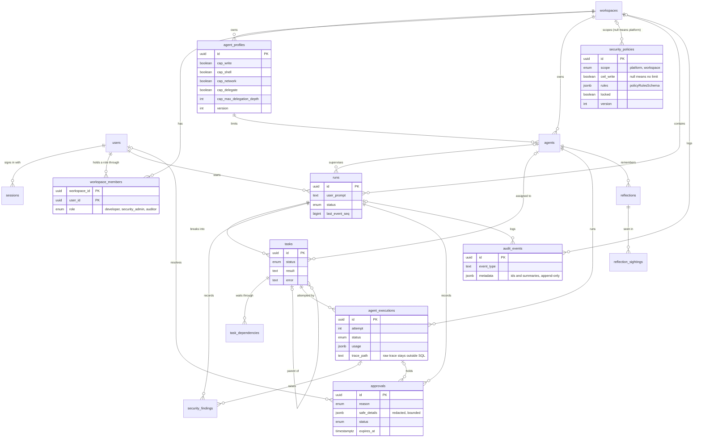

# Data model

The PostgreSQL schema from `apps/server/migrations/`. Field-level meaning lives in
`packages/shared/src`, and the reasons in `docs/contract-decisions.md`.

Rules the diagram cannot show:

- Composite keys and triggers keep a Run's tasks, executions, findings and approvals
  inside that Run, and its agents inside its workspace.
- A trigger makes `audit_events` append-only for the application.
- Agents, profiles and policies are archived, never deleted, so evidence can still
  name them.
- `reflections` and `reflection_sightings` exist but are not yet read or written.
